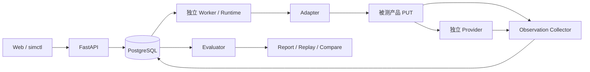

# Shadow Company

**开源企业业务仿真测试平台：在测试环境中复现退款、审批与异步故障，用独立证据发现业务错误，并将问题沉淀为发布前回归测试。**

Shadow Company 面向开发者、测试工程师和技术负责人。它把被测产品（Product Under Test，PUT）放入由组织角色、业务规则、外部依赖、时间、故障和并发条件组成的环境中，执行真实业务请求，再核验产品状态和依赖侧结果。平台适用于 AI 与非 AI 产品；核心套件采用离线规则角色，不需要模型账号。

首版聚焦**退款与审批异常测试**。完整企业模型、行业环境库和通用数字孪生是后续探索方向；当前项目以可解释的缺陷证据、输入重放和修复验证为核心。

## 为什么做这个项目

业务错误经常发生在多个条件交错时：客服重复提交、主管尚未审批、支付已经执行但响应丢失、旧回调迟到、两个请求同时争抢余额。单次请求返回成功，不能证明整条业务链正确。

Shadow Company 将这些组合写成版本化场景，让角色向 PUT 发出请求，通过独立支付账本、产品观测和审批快照核验结果。工程师可以沿证据链定位问题，将相同输入重放到修复版本，再把场景接入 CI。它补充现有接口、E2E、状态机与故障测试，不以角色数量或对话表现衡量产品可靠性。

## 工作流程

1. **定义契约**：明确标准动作、角色身份、状态所有权、观测来源、reset 方法和支持的时间/故障边界。
2. **执行预检**：检查连接、权限、证据与隔离能力；缺少必需条件时不启动有效性结论。
3. **运行仿真**：冻结环境、契约、规则、初始数据、seed 与预算，由独立 Worker 调度角色、事件、并发组和故障。
4. **收集证据**：分别追加保存 PUT 请求响应、Webhook、独立 provider 执行记录及故障命中记录。
5. **生成报告**：执行确定性规则，输出四态检查、Finding、因果时间线及 JSON/HTML 报告。
6. **重放与比较**：向目标版本重新发送输入、采集新证据，判断业务规范是否满足、修复是否得到验证。

## 核心能力

| 能力 | 实现方式与边界 |
| --- | --- |
| 组织与业务环境 | 版本化环境与 Product Contract、项目/run 隔离；首版角色包含客户、客服、审批人 |
| 三层事实 | 分离预期规则、PUT 观测和独立依赖证据，冲突保留双方来源 |
| 业务规则 | 退款幂等、累计余额、币种隔离、审批版本、终态单调性与有界完成性；金额使用整数最小货币单位 |
| 事件与故障 | 支付提交前失败、提交后响应丢失、重复/乱序回调、限流、审批人离线及受控并发 |
| 持久化与恢复 | PostgreSQL 作业、租约、心跳、检查点和追加观测；项目与 run 作用域隔离 |
| 输入重放 | Manifest 冻结版本和哈希；重放调用目标 PUT，旧响应不会作为新结果使用 |
| 角色策略 | Scripted、Rule 与受约束的可选 Hybrid/LLM 接口；核心运行路径保持无模型依赖 |
| 开发者工具 | 中文 Web、`simctl`、版本比较、JSON/HTML 报告和严格 CI gate |

检查结论为 `pass`、`fail`、`inconclusive`、`not_applicable`。运行生命周期与结论分开：`completed` 只表示执行结束。证据缺失、取消、预算耗尽和覆盖不足不能得到通过结论。

重放分为三种模式：`history` 只读历史；`input` 重新调用目标版本并采集结果；`controlled` 仅在已支持的快照、依赖和调度边界内复现。相同 seed 不代表任意外部系统完全确定。

## 首版 20 个业务场景

| 范围 | 场景 |
| --- | --- |
| S01—S04 退款与审批 | 合法小额退款、有效大额审批、未审批拒绝、修改金额后旧审批失效 |
| S05—S08 资金约束 | 重复提交、合法部分退款、累计超额拒绝、多币种隔离 |
| S09—S10 身份边界 | 低权限角色越权审批、跨客户查询隔离 |
| S11—S15 异步故障 | 提交前失败、提交后响应丢失、重复 Webhook、乱序回调、限流恢复 |
| S16—S20 并发与恢复 | 同指令并发、余额竞争、审批人离线、取消与执行竞争、Worker 中断重启 |

场景列表表示受控覆盖范围，不代表真实客户验证或无限业务空间覆盖。接入产品必须具备相应能力和证据来源；不支持的能力需要明确记录。

## 架构与目录



| 目录 | 职责 |
| --- | --- |
| `apps/web` | TypeScript / Next.js 中文控制台 |
| `services/api`、`services/worker` | Python / FastAPI API 与独立作业 Worker |
| `packages/contracts` | 严格配置、版本化契约和领域类型 |
| `packages/simulator`、`packages/evaluators` | 事件调度、角色、恢复、规则与报告 |
| `adapters` | HTTP 与可选模型适配边界 |
| `examples` | 独立退款 PUT、支付 provider、JSON-RPC 贷项单 PUT |
| `environments/refund_approval` | 可审阅的环境和业务配置 |
| `migrations`、`tests`、`scripts` | PostgreSQL 迁移、回归和开发工具 |
| `docs` | 架构、需求映射、决策与实施状态 |

主退款示例包含明确的 buggy/fixed 版本，缺陷开关仅影响 PUT 行为，Evaluator 依据真实观测核验。第二个贷项单示例使用不同协议和字段，通过 Adapter 复用业务规则；其覆盖范围限于 S01—S10，不等同于第二个客户接入。

## 本地快速开始

依赖：Python 3.12、Node.js 22—26、pnpm 11.19.0、uv 0.12.23。Python 与 JavaScript 依赖分别由 `uv.lock` 和 `pnpm-lock.yaml` 锁定。

```sh
git clone https://github.com/HashBrown-bot/shadow-company.git
cd shadow-company
uv sync --frozen
pnpm install --frozen-lockfile
test -e .env || cp .env.example .env
.venv/bin/python scripts/dev.py
```

启动器运行真实本地 PostgreSQL、迁移、API、Worker、两个示例 PUT、provider 和 Web。首次安装需要获取公开依赖；核心演示无需模型 key 或真实产品凭据。已有 `.env` 会保留，端口占用时启动器停止；Ctrl-C 停止自身子进程并保留本地数据。

| 服务 | 默认本机入口 |
| --- | --- |
| Web | <http://127.0.0.1:3000> |
| API 文档 | <http://127.0.0.1:8000/api/docs> |
| Refund PUT / Provider / Credit-note PUT | `127.0.0.1:8001` / `8002` / `8003` |
| PostgreSQL | `127.0.0.1:55432` |

这些 loopback 地址是开发服务入口。访问令牌由本机工具生成并保存在 `.local/access`；通过 Web 的本地登录使用，令牌不要提交到仓库。

保持服务运行，在另一终端执行：

```sh
.venv/bin/simctl --help
.venv/bin/simctl validate environments/refund_approval/local.e5.yaml --json
.venv/bin/simctl preflight environments/refund_approval/local.e5.yaml --json
.venv/bin/simctl run environments/refund_approval/local.e5.yaml --gate suite --output .local/fixed-report.json
.venv/bin/python -m scripts.demo_e9 --output-dir .local/artifacts/first-demo
```

演示脚本创建独立项目，依次运行 buggy、向 fixed 输入重放并比较，将报告保存至新目录。重复演示应使用新的输出目录。

`simctl` 提供 `validate`、`preflight`、`run`、`report`、`replay`、`compare`。退出码与当前操作的 gate 对应：

| 退出码 | 含义 |
| --- | --- |
| `0` | 所选 gate 通过 |
| `1` | 有完整证据确认业务失败 |
| `2` | 配置、认证、连接、迁移或基础设施错误 |
| `3` | 必需证据或覆盖不足、未完成、取消、预算终止或无法确认修复 |

预检成功不表示业务通过；部分场景通过也不表示完整 S01—S20 套件通过。

## 验证与接入

完整本地验收会启动自己的真实 PostgreSQL 和服务，执行迁移、后端回归、业务场景、重放、恢复、浏览器、构建和 CLI gate。先停止开发服务，确认默认端口空闲，再选择新的证据目录：

```sh
ACCEPTANCE_EVIDENCE_DIR=.local/acceptance-first .venv/bin/python -m scripts.verify_e9
```

命令名沿用现有执行器名称；它执行当前源码的完整验收。历史验收记录只证明其对应版本和环境，本页不把历史结果视为本次重新测试结果。

接入外部产品时，需要提供授权测试环境、独立角色身份、标准动作映射、可核验观测和依赖证据、隔离/reset 方法及明确预算。优先通过 Adapter 和契约扩展，不让 Evaluator 读取 PUT 的缺陷开关。只接入已获授权的测试系统。

## 当前边界与后续方向

当前项目是围绕退款与审批的工程原型，默认本地单团队使用。真实客户/staging 接入、生产运维、托管多租户、安全认证、实际支付、真实模型增量及市场效果都需要各自独立验证；受控示例和协议替身不能代替这些验证。

后续方向包括相邻审批/订单流程、接入辅助、已支持系统的受控时间、失败序列缩减、更多 Adapter 与环境库。完整企业数字孪生和 Marketplace 需要额外的需求与价值验证。

设计依据为仓库内《企业业务仿真测试平台项目说明书 V2》。阅读 [架构](docs/architecture.md)、[需求映射](docs/requirements-map.md)、[实施状态](docs/implementation-status.md) 和 [决策记录](docs/decisions.md)，了解具体能力与限制；贡献前请阅读 [项目规则](AGENTS.md)。

## 贡献与许可

欢迎通过 Issue 描述业务场景、提供可复现问题，或通过 Pull Request 改进 Adapter、规则、测试与文档。提交内容请使用合成数据，移除个人信息、凭据、真实业务数据及环境专属地址。

本项目采用 [MIT 许可证](LICENSE)。第三方依赖保留其各自许可证和版权要求。
