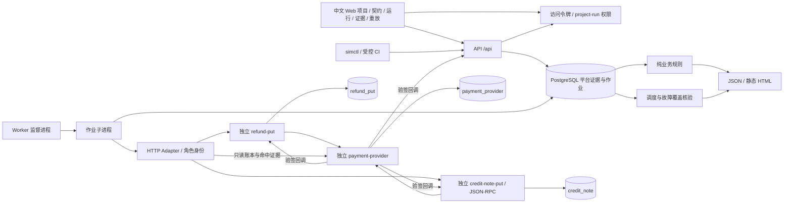
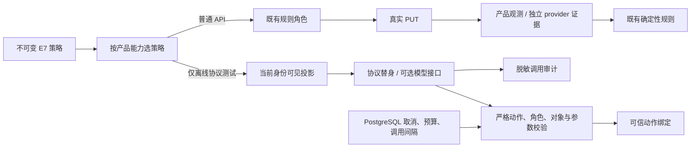

# V2 架构、访问边界与 E10 工程审查

当前仅 E10；沿用 E1 的 Next.js、模块化 FastAPI、独立 Worker、独立 PUT/provider 与 PostgreSQL。保留 E7 离线模型协议接口和 E8 中文界面，增加 simctl、严格 CI gate、本地令牌与生命周期控制、独立 JSON-RPC 第二示例；无新增模型或运行依赖。E4 历史边界和验收保留在 `acceptance-e4.md`。

## 模块和事实边界

- `packages/contracts`：严格 YAML、五条注册规则、明确故障边界。保持 schema 0.2 既有内容的规范序列化及哈希；新增故障字面值不更改旧契约记录。
- `packages/simulator/e3.py`：兼容预检、初始化、reset 与历史 S01/S02；`e4.py` 保留 S01—S10 输入与串行兼容路径。
- `e5.py`：生成实际输入，冻结事件、因果关系和 `e5-schedule-1` Manifest；执行持久检查点、barrier、取消与预算。它不向业务规则提供预期答案。
- `jobs.py`：作业 owner/epoch、租约续期、每 run 会话锁、原子派发前检查、取消和追加运行日志。
- `services/worker`：监督进程与可被中断的作业子进程。监督进程只重启进程；业务恢复决定来自 PostgreSQL 和远端证据。
- `adapters/http`：真实 HTTP 与身份映射，脱敏记录请求、响应和计时。E5 绑定已冻结事件；恢复查询是新增观测，不复用旧输出。
- `evaluators/refund.py`：只使用 Policy、来源观测和完成/时间上下文。`runtime.py` 另核验故障、实际重叠和中断恢复的覆盖证据；不读取 PUT 版本开关决定业务结果。
- PUT 独占业务状态、审批、余额及 fixed/buggy 行为。provider 独占支付、幂等、账本与故障，不替 PUT 执行审批或累计余额政策。

预期政策、PUT 观测与 provider 证据继续分开。全部运行记录有 project_id/run_id。四个持久化范围共用开发账号，是工程边界，不是数据库账号或 OS 安全隔离。服务间经过真实 HTTP。

## 稳定事件与真实时间

API 在同一事务保存 run 输入、内容哈希、事件、消费状态、作业及不可变 Manifest。事件 UUID 基于本 run 与计划序号，故意重复业务动作有不同 ID；同事件再次消费以 `event_dispatches` 判重。排序为模拟时间、优先级、接收序号、事件 ID；并发兄弟事件共用因果前驱。

`simulation_time` 使用明确的 UTC 2000-01-01 基点加相对事件间距；这只是平台日程。`wall_time` 为实际接收计划时间，动作/运行日志另存真实开始、结束和数据库顺序。业务时区来自原契约。`realtime` 保留平台间距，`event_compressed` 跳过平台间距；两者都等待真实观察窗口。没有外部测试时钟接口，schema 拒绝 runtime.time_mode=controlled。replay.mode=controlled 的有限控制范围见 E6 一节。

历史 Manifest `e5-schedule-1` 保存契约/输入/调度哈希、故障计划与时钟边界，只用于 E5 恢复与追溯；这些旧记录不具备 E6 所需的完整清单。新 E6 Manifest 见下文。

## 租约、检查点和未知结果

作业租约为 3 秒，独立线程每 0.5 秒续期。每次认领递增 epoch，派发和确认检查 owner/epoch/租约。长期持有每 run 的 PostgreSQL 会话锁，租约过期但旧进程仍在执行时，新进程不能并行接管；进程退出释放会话锁。其他 run 不共享这个锁。

派发事务锁定作业行，检查取消、事件与墙钟预算、事件消费状态，随后保存 inflight 意图与 Action；之后才发 HTTP。确认事务更新 done 并追加 journal。取消 API 使用同一作业行锁：线性化点之前派发的动作属于在途动作；之后不准派发。

| 中断位置 | 恢复语义 |
| --- | --- |
| 派发意图之前 | 事件仍 pending，新 owner 可派发；S20 实际子进程退出验证 |
| 意图已保存，远端结果未知 | execute 先查询 PUT 与独立账本；无法证实结果则 unknown，停止运行，不重发 |
| provider 已提交、HTTP 仍在途 | 等租约过期后核验；真实 SIGKILL 测试确认仅一笔资金 |
| 收到结果、未保存观测或确认 | S20 实际退出；查询和账本确认成功后推进 checkpoint，不再次执行 |
| 响应与观测已持久化，尚未确认事件 | 检查持久响应状态，执行类仍核验独立资金证据；不能只凭 end_time 确认 |
| GET/真实等待中断 | 可重读/重新等待，不能跳过未完成观察窗口 |
| 旧 E3/E4 串行作业中断 | 无 E5 事件检查点，不重新执行，明确标记 remote_outcome_unknown_legacy_scope |

S20 的 `os._exit(86)` 在 journal 提交后立即退出，不运行 finally。每个计划位置只触发一次；新 owner 和 PID 可核查。外部测试另用 SIGKILL，不把优雅停止冒充进程崩溃。

## 故障和真实并发

每项故障保存 fault_id、命令匹配、尝试次数、次数上限和持续时间。服务在自己的 schema 存计划、命中和调用审计；平台经只读 HTTP 取回为不可变观测。没有计划命中证据不能称场景通过。

- S11：provider 在写账本之前截断 HTTP 响应连接，真实客户端发生连接读取失败。它覆盖连接中断，不宣称模拟 DNS 或 TCP 建连拒绝。Uvicorn 的 Content-Length 中断日志是计划故障记录。
- S12：先提交 ledger 和命中证据，事务退出后不发送响应头，直到客户端实际读取超时断开。fixed 查询幂等执行；buggy 更换键重试产生两条真实账本。证据包含提交序号、entry_id、PUT 超时和后续调用。
- S13/S14：重复同事件，或把成功执行前已保存的处理中回调延迟发送。发生时间和 state_version 可核验；仅写“旧版本”而缺历史时间不能消除冲突。投递日志保存收件侧响应，平台去重不删除 provider 的重复投递证据。
- S15：独立 provider 返回 429，随后正常执行；实际调用和有界等待保留。S18：真实审批请求收到身份不可用的 423，真实等待后，未审批执行被拒绝。
- S16/S17/S19：平台线程 barrier 和 PUT 入口 barrier 集齐后释放，记录双方到达、释放、请求开始/结束序号和时间。S17 buggy 在余额读取后再次同步，使用过期余额执行；fixed 在产品事务锁内重新核验余额。S19 以产品锁决定执行或取消先赢，已执行资金不得被取消抹掉。

取消或预算不足停止新事件；先等已派发并发组结束，再最多进行 3 秒只读后果收集，缺失记为不确定。max_events、max_wall_seconds、max_concurrency、max_action_retries 实际生效；模型关闭、调用和 token 为 0。只读收尾开销与在途动作会使最终墙钟超过派发预算，报告不把超出的时间藏起来。

## 规则、报告、持久化与限制

E4 五条业务规则、四态、七类归因、Finding 去重、不可变评估历史和反证保留。成功不能由 PUT 自证；按唯一 entry_id 计数、按支付/币种累计、审批绑定快照、终态回退和真实完成窗口继续有效。

E5 报告增加事件、消费状态、journal、真实动作重叠、故障命中、恢复和计时。覆盖层核对所有计划动作的数量及 E5 必需证据；S20 经独立核验的执行附恢复记录，不能把缺少普通重复请求视为已覆盖。`gate` 仅为 refund_core_20，不是 V2 发布结论。

发生器准备时间、线程 CPU、run 墙钟与 PUT HTTP 往返分别报告。发生器准备包含 barrier 等待，PUT 往返包括依赖等待；不推断服务器 CPU 或吞吐量。

迁移 `0004_e5` 增加消费检查点、journal、租约 epoch、真实动作顺序及两个服务的故障/审计表，不覆盖旧迁移或契约。真实 PostgreSQL 验证空库、含 E4 记录升级、重复迁移及降级/升级。受审计 reset 增加新表清理；跨服务失败保留 reset_incomplete。

默认 loopback、出站 allowlist、固定 IP 连接、HMAC 验签、追加观测、敏感头脱敏及按进程测试凭据继续有效。API 现在要求本机令牌，宿主 OS 与数据库仍信任同一团队。未验证同时杀死 PUT/provider 的通用恢复、真实客户、实际付款、生产、完整安全审计或真实模型服务；E10 未开展。外部产品需另行声明和审阅恢复、幂等、权限与时钟能力。

## E6 输入资产与不可变历史

`contracts/replay.py` 定义严格的三模式请求与 ActorFixture；不接受可执行配置、未知字段或 true/字符串形式的输出复用。`simulator/replay.py` 管理快照、角色/故障 fixture、Manifest、Worker 匹配器与只读 history。`evaluators/comparison.py` 从新旧独立证据比较业务结论及影响归因的条件。`services/api/replay.py` 只在目标契约明确且通过预检时创建新 run。

迁移 0005_e6 增加按 project/run 绑定的 `replay_assets` 与 `replay_seals`。普通 UPDATE/DELETE 被数据库触发器拒绝；审计 reset 才能删除对应 run。旧契约、旧迁移和 E5 Manifest 不改写；旧运行可读历史，但不凭当前代码补造旧版本的 replay 清单。

新 e6_core_20 基线和 input/controlled 运行的计划 Manifest 均使用 `e6-replay-1`。三个资产分别是初始 payments、语义角色输入和故障计划，既保存内容又保存 SHA-256。初始业务快照哈希与含本轮 Webhook binding 的具体 seed 哈希分开，前者用于条件比较，后者必须由两个服务的 seed 响应核实。

计划 Manifest 保存环境、规则配置和规则代码、不可变契约版本/哈希、目标 PUT 版本、adapter、平台源码、依赖解析版本和双锁哈希、PostgreSQL、seed、时间/预算、角色、故障、计划调度及控制边界。版本元数据在进程启动/模块加载时冻结，Worker 与独立服务在业务开始前核验一致性。没有 Git commit 时保留 null 和逐文件内容哈希；不把未提交工作树说成已提交发布版本。

完成或停止后追加 completion seal，关联原计划哈希，保存真实事件状态、动作开始结束、journal、命中、barrier 与报告哈希。GET report 仍从当前证据检查完整性；旧 seal 保持不变。资产或观测后续丢失会使当前报告/compare 阻断通过；history 仅 SELECT 历史记录，不调用 report、HTTP 或更新作业。

## E6 执行、fixture 与路径偏离

重放复制源计划及资产到新 project/run 范围，用新的 binding、事件、观测和账本 ID。目标版本来自显式目标契约，并由 PUT 每次业务请求的服务端审计和版本/构建响应头再次证实。provider 独立记录本轮收到的执行、提交与回调；它不读取业务评估结果。旧响应不会作为新输入资产或新结果注入。

Worker 继续使用 E5 的 owner/epoch、检查点、barrier、取消和预算。在业务事件前，以当前角色执行真实查询，按动作语义、对象、角色、请求参数、当前金额/币种/收款方/版本等前置条件匹配 fixture。客户权限探测只看该客户自己的响应。重复动作以 fixture 的用途次数计数，匹配不依赖历史调用序号；歧义和缺失停止为 fixture_mismatch，归因 environment_error，不制造 product_defect。

provider 故障使用 `semantic.operation/fields/state`，核验自身是否已有提交、业务对象和请求字段，次数上限针对符合条件的命中。E6 当前只支持一次、首个满足前置状态的命中；其他旧 attempt 位置不能直接映射，明确拒绝。测试在第一次请求语义不匹配后，第二次匹配请求才得到 429，证明未按旧序号机械返回。正常 ledger/outbox 每次由新请求生成，不保存可用于替换产品结果的 response fixture。

默认 scripted_v1 固定业务动作；反馈策略 retry_if_unsettled_v1 只支持 execute：根据角色可见的新状态，已结束则 skip，否则派发已冻结动作。每次决策保存策略版本、原因和输入不相同标记；不生成模型调用。若跳过的是 S05 的必需重复动作，报告为 inconclusive，不能把减少输入误当产品修复。PUT 自己减少 provider 重试或增加查询对账则属于产品路径变化，不因此判 fixture 错误。

## E6 三模式和比较边界

history 为只读快照；input 实际运行于新命名空间。controlled 使用相同真实执行链，但只接纳相同的已审阅环境、规则、预算及控制契约，并验证示例的控制能力。控制范围是初始化、语义故障、平台事件排序、回调投递及入口 barrier。runtime.time_mode 仍仅 realtime/event_compressed；墙钟、OS 调度、网络延迟、数据库锁胜者、UUID、外部系统均不在确定性承诺内。S19 不预设谁赢。

比较先核实目标新证据和资产完整性，再对规则/业务对象比较四态结果。PUT 版本/构建变化与规则、环境、契约语义、provider/adapter/平台、依赖、seed、预算、快照、角色/故障 fixture、归一化事件计划分开。归一化仅移除新 namespace binding 和目标版本选择等必然不同的执行标识；实际原值和独立哈希仍完整保存。规则或环境同时变化，不能把通过直接归因 PUT。

`repair_verified` 需要源有已确认失败、目标 completed/pass、全部原失败转为 pass、条件可比且有独立新调用/证据。expected_path/actual_path 与合法产品路径变化、输入偏离、不可比较项一起展示。JSON、HTML 和最小 Web 重放入口都使用后端结论；没有在前端判资金成功，也没有综合 readiness 分数。E8 增加完整中文控制台；E9 的 CLI/第二适配器和 gate 见下文，E10 未开展。

## E7 角色与模型边界

`contracts/actors.py` 使用独立版本化策略 `e7-actors-1`，不扩展 v0.2 业务契约的默认字段，旧规范序列化和哈希保持。`simulator/actors.py` 的 observation、动作校验、预算与审计是唯一模型边界；`adapters/llm/protocol.py` 只负责结构化请求/响应，不得到数据库、HTTP、provider 或凭据句柄。当前注册的唯一适配器是明确离线的协议替身；没有供应商网络实现。

普通 API 的 S01—S20 始终走规则角色；hybrid 记录选择原因。S09/S10 的故意越权请求由规则角色使用真实低权限身份发送，平台模型动作拦截不替代 PUT 权限测试。`send_message` 仅是有自然语言入口时的受限协议动作；本机 PUT 没有该能力，因此没有把假聊天作为业务场景。

模型观察由服务器构造：查询同时约束 project_id、run_id、actor_id、source 和业务路径，再筛选已分配对象/允许字段。拒绝请求的 body、provider 账本、管理接口、其他角色与其他 run 记录都不进入观察。产品文本明确作为不可信数据；它可以影响受限角色输出，不能改变系统指令、规则、身份、预算或工具集合。状态/金额仍是产品声称，资金与权限由独立证据裁决。

模型请求携带 schema、允许工具、策略版本与当前身份投影。只有严格 JSON、注册工具、准确角色、已分配对象和类型合法的参数才能返回可信调度侧；不接受 URL、任意函数或规则内容。最多有限修正，最终 `actor_error` 只归因角色，不能算产品缺陷。

## E7 持久预算与审计

迁移 `0006_e7` 追加 `actor_policies`、`actor_calls`、`experiments`、`experiment_runs`、`finding_reviews`。所有按 run 的记录含 project_id/run_id；实验父记录按 project_id/experiment_id，成员使用复合外键关联 run。策略、调用阶段与复核记录追加保存并受不可变触发器保护。

模型调用开始前，复用现有 owner/epoch、作业行锁、取消/墙钟检查，持久预占调用次数及保守用量。每 run 最小调用间隔由 PostgreSQL 时间约束；等待可取消。返回后保存脱敏输出、用量来源及错误，再检查预算、取消与动作权限。返回超限也保留实际后果与用量，停止为 `model_budget_exhausted`。未知调用保留预占且不无条件重发。已有 `Lease.check` 与事件派发不再把模型计数覆盖为 0。

本次协议替身使用可直接测量的 UTF-8 单位加输出上限预占，不冒充供应商 token。真实供应商的用量计量、截止/断连接、价格与全局速率限制仍未测试，不能把当前每 run 限流宣称为服务级配额。脱敏扫描不读取真实凭据；输入白名单与文本清理不构成任意私有文本的通用 DLP 保证。

重放继承冻结的 E7 角色策略；比较把策略变化单列，不能因更改角色而声称 PUT 修复。history 继续只读，包含新审计。reset 保存这些表的计数/哈希后清理目标 run；实验成员作为关联已重置运行的墓碑保留，报告显示证据不可用，不补造指标。缺策略或调用记录会使当前结果不确定。

## E7 配对指标与未测项

`services/api/experiments.py` 复用既有 run 入队路径，每个 seed 保存同一份不可变业务契约供 rule/hybrid 两侧使用。`evaluators/experiments.py` 比较实际 Manifest 的产品、规则、环境、seed、快照、输入调度、依赖、控制范围和预算，并核验封存与新证据。策略是实验变量，其余条件变化、缺 run 或不完整运行都阻断可比较结论。

规则发现按原有 Finding 语义报告，不将每个告警当独立根因。人工 review 必须关联本实验当前有产品证据的 Finding、当前证据哈希与显式根因组；按根因组跨 seed 去重。误报、独立缺陷与确认耗时未采集时为 null，部分复核明确显示覆盖数量。测试用合成 review 仅验证协议，不当作真实人工时间。无模型调用的费用 0 有明确来源，基础设施费用、真实模型成本、AI 增量和市场效果均未测。

E7 只交付离线边界、协议验证和普通 API 配对运行。E8 已增加中文界面；E9 的新增能力见下文。公网托管、多租户和 E10 发布未开展。

## E8 中文控制台与读取投影

`apps/web/app/components` 按项目、契约、运行配置、运行详情、Finding 与重放比较划分视图。浏览器只保存 URL 导航状态、表单与网络状态，通过受限同源 BFF 调用既有 API；无模拟数据存储和前端业务评估。运行/重放 POST 使用请求幂等键，超时不会自行合成成功。

`services/api/console.py` 增加当前项目、契约/预检与运行列表、run console、Finding/检查/证据分页、因果时间线。它读取原有 PostgreSQL 表并调用原报告器，从同一规则结果构造页面。目录模板读取已有 `local.e5.yaml` 并经原 `Configuration` 解析；原业务 schema、旧哈希和迁移不变。

租约失联由数据库时间与 expires_at 推导，生命周期与 verdict 独立返回。运行详情轮询同一 run；项目切换取消旧请求，故障响应撤下该查询的结果。项目/run/Finding/compare 地址可刷新恢复。分页最多 100 条，UI 默认 5/10 条。

时间线联合真实动作、观测和当前评估检查，使用四类来源。角色记录关联事件前驱，产品/支付观测关联真实 action 或保留无关联状态，evaluator 引用 evidence_refs；排序时间不是因果证据。原始请求/响应继续经既有证据层脱敏，只展示受限存储中的脱敏载荷。

以上是保留的 E8 界面设计。E9 在其外增加本地登录和逐请求授权。真实模型实验继续未执行，工程 UI 与本机示例验证不等同客户验证、E10 或生产就绪。

## E9 CLI 和统一 gate

`packages/simctl` 是薄客户端，经真实 API 调用 validate、preflight、run、report、replay、compare。所有输出使用 `simctl-1` JSON；HTML 是显式导出格式。参数、配置和连接错误经过固定错误类型清理，不回显输入原文。CLI 只向批准的本机 8000 origin 发送令牌，不读取 OS 代理，不跟随重定向。

`evaluators/gates.py` 从原报告生成 `e10-gate-2`，由统一报告器放入 `ci_gates`，API、CLI/CI、HTML 与 Web 共同使用。业务四态和 run 生命周期保持原含义。代码 0 要求所选范围通过、全部必需规则有适用且带证据的通过检查；全为 N/A 不满足要求。完成且确认产品缺陷为 1；执行基础设施错误为 2；取消、预算未完成、缺证据及未确认修复为 3。validate/preflight/history 的 0 只针对各自 gate，输出明确不代表业务通过。

## E9 访问边界和私有证据

`transport/access.py` 逐请求验证随机本地 Bearer 的 SHA-256、有效期、撤销、project/run 范围及 read/run/evidence/raw/admin 权限。registry 和客户端文件限 0600，拒绝符号链接。默认拒绝未配置认证；只有 health 和另行验签的 Webhook 不使用 Bearer。列表按项目授权过滤，读取/修改/比较都核对作用域；run 范围令牌不能创建或改变项目输入。签发是受信 OS 操作者的本地工具，未增加公网注册或托管 IAM。

浏览器提交本地令牌到同源 session 路由；它向固定 API 验证后写入 HttpOnly、SameSite=Strict、一小时 cookie，不写 localStorage。BFF 转发当前用户令牌，API 再授权；BFF 的路径/查询/Origin 检查仍有效。默认 HTTP loopback 因而 cookie 不设置 Secure；上线 HTTPS、SSO、限流与敌对租户隔离均不在已验收范围。

原观察仍追加保存并保留非法业务值，授权头、cookie、密钥及回显先脱敏。迁移 `0007_e9` 为新观察增加私有协议副本及到期时间；raw 接口额外核对 raw 权限和期限。历史 trace 中保留评估/审阅所需的脱敏事实，普通 evidence 授权只能读取已脱敏证据；没有未脱敏凭据仓库。凭据文件和服务器 registry 不进入导出或源码。文本扫描与人工截图复核各有明确范围，不宣称通用 DLP。

传输仍使用操作员 exact-origin/IP allowlist、完整 DNS 结果校验、数字 IP 连接、禁止重定向及代理。第二产品只增加已审阅的 8003 origin。provider 的回调目的地由绑定范围内的管理配置固定为 8001 或 8003，首次执行后不可改；API 回调也固定。HMAC 覆盖时间戳、范围和原始字节，五分钟窗口及 event ID/摘要去重防止重复生效。

## E9 生命周期和迁移

`0007_e9` 追加 projects.stopped/deleting、不可变 lifecycle_audits、private_evidence、独立 credit_note schema 与 provider 命名空间的回调 origin。旧迁移和业务契约不覆盖，v0.2 adapter 注册枚举扩展并同步导出 Schema，旧契约的序列化及哈希不变。

`new_run` 在项目共享锁下检查急停/删除标记；急停取得排他锁后取消 queued/leased 作业，阻止新的预检、普通 run、重放或实验。派发路径在作业锁下检查取消，串行兼容路径也在动作/等待边界检查。已派发动作可能结束并保留后果，急停不能撤回支付。

原始私有副本默认七天，到期读取即拒绝；脱敏 trace 默认三十天。管理员显式 retention 清理过期私有副本，trace 通过远端 reset 后清理。运行中的 trace 延期并返回 complete=false。没有创建外部或内置定时任务；需要操作者定期调用，未调用时过期数据可能仍物理存在。

项目删除先冻结新运行并等待在途结束，逐 run 成功清理两侧产品/provider 后才清理该 run 平台证据，最后删除契约、索引和项目。单个远端失败保留该 run 平台证据并返回 503；已成功 reset 的 run 不回滚，这是有审计的跨服务非原子流程。生命周期审计仅保留 UUID、操作、时间和数量，不含项目名或业务载荷；不可变触发器只接受同项目/run 的指定清理授权。备份、手工导出的文件和旧验收产物不在在线删除范围。

## E9 第二 Adapter 与核心变动边界

独立 `credit-note-put` 使用 JSON-RPC 2.0 单入口、贷项单字段和独立数据库状态，实际请求 provider 并接收验签回调。`rpc_credit_v1` 将 canonical 动作映射为 notes.issue/authorize/revise/settle/fetch 等方法，并同时保存 wire 观测。映射只重命名，不把错误值修正为合法值。它没有导入原 PUT、模拟 Runtime 或规则；接入时未修改五条业务规则，buggy 旧审批漏洞由同一 APPROVAL_001 检出；E10 的跨 Adapter 类型/证据健壮性修复另以 refund-v2 版本记录。

通用核心补充只有 Adapter 工厂/传输覆写点、provider 按作用域选择回调目标、注册 Schema 和明确的能力拒绝；具体原因见 D052。第二示例仅覆盖 S01—S10，使用保留的 E4 报告格式（其历史 schema_revision 字段不是物理数据库迁移 head）；物理数据库为 0007_e9。第二示例不支持 E6 replay、E5 故障/barrier，路由明确拒绝这些请求。主示例继续验证完整 S01—S20、恢复及重放。

## E9 本地交付与 CI 边界

dev.py 是 Docker Compose 的等价本地启动器：真实 embedded PostgreSQL 18.4、迁移、生成本机测试身份、API/Worker/两个 PUT/provider/Web；seed 按不可变契约写入新命名空间。所有端口只绑定 loopback；端口被占用即停止，不杀未知进程。clean_e9 在新源码目录、新虚拟环境、新 node_modules 和新数据库里实际安装和启动，仅可复用下载缓存。

CI 配置固定 actions SHA、只读权限和双锁依赖，默认关闭模型并运行受控回归及 strict suite gate；没有开放探索或外部 schedule。未人工确认的探索发现不会进入发布门禁。当前仅在 macOS 执行同一流水线；GitHub/Linux 配置交付但外部 runner 未执行，不能把本机通过推广为跨平台或生产验收。

## E10 报告一致性与规则演进

业务 verdict、生命周期和严格 CI gate 分离。report() 完成当前证据/运行/重放核验后统一生成 selected/suite gate；console 只投影该报告，前端不重算资金或 gate。compare_runs 在同一次当前目标报告上同时提供 target_ci_gates 与比较 ci_gates，CLI 和 Web 都消费它，避免两次读取之间证据清理造成相互矛盾的结论。S12 范围内修复可成立，但缺少审批适用覆盖的严格 gate 仍为3。

当前 Evaluator 为 Policy 2 / refund-v2，严格校验独立初始支付币种与整数余额、审批金额和版本；原始非法值不改写。报告记录进程冻结的 evaluator_build。比较同时核对当前实际规则构建与目标 Manifest、当前政策版本/哈希与目标 seal，规则漂移阻止“只修复 PUT”的归因。契约注册规则参数版本和实际 Evaluator 版本分别展示。旧历史、旧 Manifest 和 seal 不补写新版本。

运行层 fixture 环境问题保存独立 execution_issues，含真实原因、脱敏详情和稳定引用；业务 checks 仍保留自己的证据缺口。checks 读取需要 evidence 权限；规范 recipient 与第二协议 payee 使用一致摘要，授权头、已知请求凭据回显和本机访问令牌在共享文本及模型审计边界清洗。扫描是限定模式与本次生成秘密的核对，不冒充通用 DLP 或正式安全认证。
